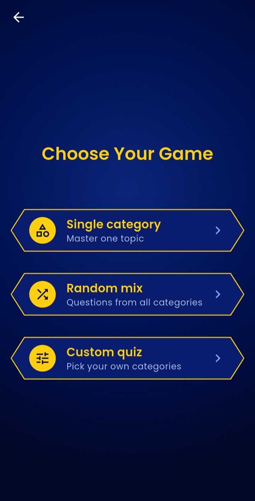
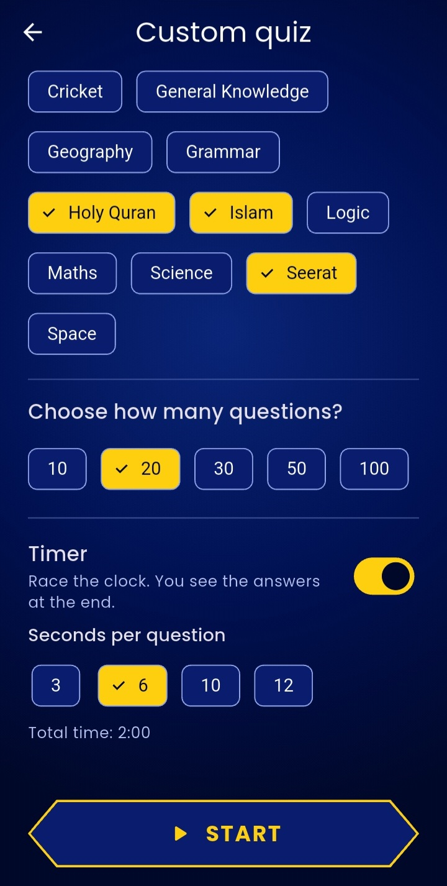
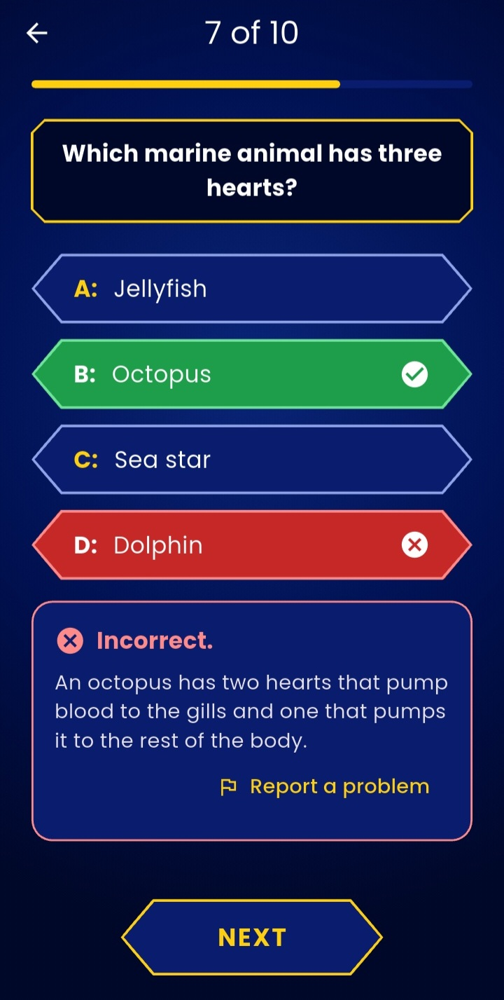
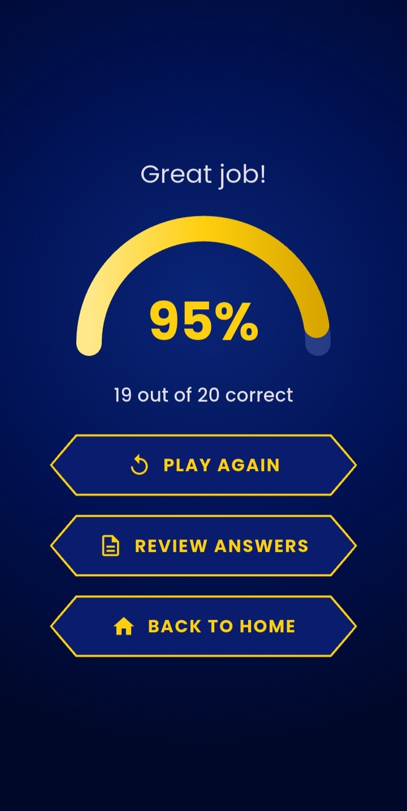

# Quirozity

**Quiz your Curiosity.**

Quirozity is an offline-first quiz app built with Flutter. Download the questions once, then play anywhere: pick a category, mix topics in a random round, or build a custom quiz. Play at your own pace or race the clock, and review every answer with its explanation.

> Portfolio project: a full-stack app with a Flutter client and a Spring Boot + PostgreSQL backend (separate repository: `https://github.com/hamza-1605/quiz-backend`).

## Screenshots

| Welcome | Choose your game | Custom quiz |
|---|---|---|
|  |  |  |

| Question | Timed round | Results |
|---|---|---|
|  |  |  |

## Features

- **Three ways to play:** a single category, a Random mix of all categories, or a Custom quiz where you choose at least two categories.
- **Balanced rounds:** 10, 20 or 30 questions (50 for mixed rounds), spread as evenly as possible across the chosen categories, with no repeated question in a round.
- **True/false and multiple-choice questions** with shuffled options, optional images and explanations.
- **Normal mode:** submit an answer and immediately see whether it was right, with the explanation.
- **Timed mode:** one countdown for the whole round, with the answers revealed at the end. Unanswered questions count as wrong.
- **Results:** an animated score gauge, a full question-by-question review, "play again", and confetti for a perfect score.
- **Offline-first:** after the first download, everything works without internet. The app checks for new content quietly at startup, and you can check manually in Settings.
- **Images cached for offline use,** and pre-downloaded during the first setup.
- **Sound effects** with an on/off switch, and a **feedback form** to report a typo or a wrong answer.

## Architecture

Clean Architecture with **GetX** for state management, dependency injection and routing, organised feature-first.

```
lib/
├── core/                 shared code: database, theme, routes, DI, widgets, sound
└── features/
    ├── sync/             content download, version check, image pre-download
    ├── categories/       welcome flow, category list, mode choice
    ├── quiz/             round setup, questions, results, review
    ├── settings/         sound switch, update controls, about
    └── feedback/         report a problem, sent to a Google Sheet
        ├── domain/       entities, repository interfaces, use cases (pure Dart)
        ├── data/         models, data sources (SQL, HTTP), repository implementations
        └── presentation/ pages, widgets, GetX controllers and bindings
```

The dependency rule: `presentation → domain ← data`. Controllers call **use cases**; use cases depend on repository **interfaces**; only the data layer knows about sqflite, HTTP or JSON.

## How the offline sync works

1. On startup, the app reads the stored content version and asks the server for the current one (a tiny request).
2. If they match, nothing is downloaded. Otherwise it downloads the whole content snapshot.
3. In **one database transaction** it deletes the old categories, questions and options, inserts the new ones and stores the new version. If anything fails, the transaction rolls back: the old content and the old version stay untouched, and the next attempt simply retries.
4. After a successful check, any category or question images missing from the cache are downloaded in the background. Failed downloads never fail the sync, and they are retried next time.
5. A round keeps its questions in memory, so a sync can never change a round in progress.

The backend is hosted on a free tier and can take up to a minute to wake up. Sync calls use generous timeouts, show a "server is waking up" message, and never block gameplay.

## Interesting implementation details

- **Balanced question selection:** a "dealing cards" algorithm splits the requested count evenly across categories, caps each category at what it has, and redistributes the leftover. It is unit-tested.
- **Timer:** based on a stored deadline, not a counter, so time keeps running if the app goes to the background.
- **Typed results and errors:** sealed classes (`SyncResult`, `AppException`) make the UI handle every case.
- **Custom UI components:** pointed-end answer buttons and panels built with a custom `ShapeBorder`, an animated semi-circle gauge drawn with `CustomPainter`.
- **Fonts and sounds are bundled** in the app, so nothing is downloaded at runtime.
- **Feedback pipeline:** a Google Apps Script web app validates each report, neutralises spreadsheet formulas and appends a row to a Sheet. The endpoint URL is injected at build time and kept out of the repository.

## Tech stack

| Area | Choice |
|---|---|
| Framework | Flutter / Dart |
| State, DI, routing | GetX |
| Local database | sqflite (hand-written SQL) |
| Networking | `http` |
| Image caching | `cached_network_image`, `flutter_cache_manager` |
| Audio | `audioplayers` |
| Effects | `flutter_confetti` |
| Tooling | `flutter_launcher_icons`, `flutter_native_splash` |
| Backend | Spring Boot + PostgreSQL (separate repository) |

## Getting started

Requirements: Flutter (stable channel) and an Android device or emulator.

```bash
git clone <this repository>
cd quiz_app
flutter pub get
```

Create `env.json` in the project root (it is git-ignored). `env.example.json` shows the format:

```json
{
  "FEEDBACK_URL": "your Google Apps Script web app URL"
}
```

Point the app at your own backend in `lib/core/constants/api_constants.dart`, then run:

```bash
flutter run --dart-define-from-file=env.json
```

Without `FEEDBACK_URL`, the app runs normally and the feedback form reports that feedback is unavailable.

### Release build

```bash
flutter build apk --release --dart-define-from-file=env.json
```

Release signing uses `android/key.properties` (git-ignored). Without it, the build falls back to the debug key, which is fine for local testing.

## Tests

```bash
flutter test
```

## Credits

- Fonts: Poppins and Cinzel, licensed under the SIL Open Font License (see `assets/fonts`).
- Sound effects: `Downloaded from various free stock websites`.

## Author

Built by Hamza. `https://github.com/hamza-1605/`
